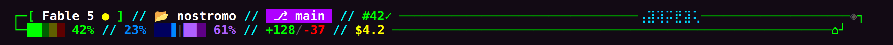

# 🎮 retro-hud

> A retro sci-fi HUD status line for [Claude Code](https://claude.com/claude-code) — neon wireframe, zoned gauges, and a resident pixel creature.




Two rows in a closed $\color{#00ff00}{\textsf{neon green}}$ wireframe with
$\color{#00ffff}{\textsf{cyan}}$ `//` separators and a [pixel creature](#agent-presence)
standing on top, showing every number Claude
Code will give you — rendered with width-aware degradation so it never
overflows, and a top-level guard so a malformed payload degrades gracefully
instead of crashing.

## Quick start

```bash
git clone https://github.com/codyslater/ccstatusline_retro-hud.git
cd ccstatusline_retro-hud
bash install.sh     # backs up settings.json before touching it
# or: bash install.sh --hooks   (also lets the creature see permission prompts)
# existing install with local edits: bash install.sh --hooks-only (touches only the hooks)
```

Restart Claude Code. Preview any time without it:

```bash
python3 statusline.py --demo
```

To remove: `bash uninstall.sh`.

**Requirements:** Python 3.6+ (stdlib only, no subprocesses), Claude Code
2.1.153+, a 256-color terminal. A font with fractional block characters
(JetBrains Mono, Fira Code, any Nerd Font) makes the gauges crisp.

## What it shows

### Row 1 — identity

| Segment | Looks like | Appears |
|---------|-----------|---------|
| Model + effort | `[ Fable 5 ◉ ]` — dot scales `·` `•` `●` `◉` `✦` with effort level,  | always |
| Directory | `📂 my-project` | always |
| Git branch | `⎇ main` on a $\color{#af00ff}{\textsf{purple}}$ badge, hyperlinked to the repo | in a git repo (read straight from `.git` — works in worktrees and on detached HEADs) |
| Pull request | `#42✓` — ✓ $\color{#00ff00}{\textsf{approved}}$, ○ $\color{#ffff00}{\textsf{pending}}$, ✗ $\color{#ff0000}{\textsf{changes requested}}$, ◌ draft; hyperlinked | while a PR is open for the branch |
| Vim mode | `[N]` `[I]` `[V]` | vim mode enabled |
| Session name | `◈ fix-login-flow` (capped at 28 cols) | named sessions, wide terminals |

### Row 2 — instruments

| Segment | Looks like | Appears |
|---------|-----------|---------|
| Context gauge | $\color{#00ff00}{\textsf{green}}$ / $\color{#ff8700}{\textsf{amber}}$ / $\color{#ff0000}{\textsf{red}}$ zoned track with fractional fill, `72%` | always |
| Context tokens | `144.2K/200K` (or `/1M`) | from the amber zone up, when headroom is an actionable number (`RETRO_HUD_CTX_TOKENS=always\|never` to pin) |
| Rate limits | mirrored gauges, $\color{#0087ff}{\textsf{blue}}$ 5h ←`██\|██`→ $\color{#af5fff}{\textsf{violet}}$ 7d | Claude subscription plans (hidden when the API reports none) |
| Lines changed | `+1447/-455` — $\color{#00ff00}{\textsf{green}}$ / $\color{#ff0000}{\textsf{red}}$ | when nonzero |
| Cache hit rate | `cache 94%` in $\color{#00ffff}{\textsf{cyan}}$ | terminals ≥ 140 cols |
| Duration ↔ cost | one field alternating every 30s: `1h` in $\color{#ff0087}{\textsf{pink}}$ ↔ `$41` in $\color{#ffff00}{\textsf{yellow}}$, both rounded hard (whole hours, minutes to 5; two significant figures of cost), so the flip moves its neighbours by a cell at most; no padding (`RETRO_HUD_COST_MODE=both` for two segments) | always; cost alone on narrow terminals |
| Agent / worktree | `▐█ reviewer` in $\color{#00ffff}{\textsf{cyan}}$ / `⎇ feature-x` in $\color{#ff0087}{\textsf{pink}}$ | `--agent` / `--worktree` sessions |
| Home link | `⌂` in $\color{#00ff00}{\textsf{neon green}}$, hyperlinked: a jump-home link for multi-session setups — point it at any URL your desktop can open, e.g. a custom scheme that switches tmux sessions | `RETRO_HUD_HOME_URL` set; sits at the right edge of row 2, just inside the `┘`, never dropped as the terminal narrows |

### Rate-limit label escalation

| Usage | Label behavior |
|-------|----------------|
| < 70% | cycles `35%` ↔ `2h45m` every 30s — the gauge stretches to absorb the width difference, so nothing shifts on a flip |
| 70–89% | stops rotating and pins both numbers, mirrored so the % always touches its own bar: `20h30m · 77% ▎███\|███▊ 77% · 20h30m` |
| ≥ 90% | same, in $\color{#ff0000}{\textsf{red}}$ — the % is never dropped, so you can see how close you are to 100% |

Once a gauge is in the amber zone its label never flips back to rotating:
the pinned `% · countdown` is the **last** thing row 2 sheds as the terminal
narrows, after the cache readout, token counts, diff stat, agent name, and
session duration. Each gauge escalates independently, so a calm limit keeps
cycling beside a warning one.

### Agent presence

A small pixel creature lives on the top frame rule and acts as the visible
presence of the agent running in that session: it wanders, blinks,
breathes and hops while things are calm, hurries while the agent works,
waves when the turn is yours, bounces when a permission prompt is waiting,
and dozes off when nothing happens. By default it speaks only when
something needs you (`need you`, `compact?`, `limit soon`) or when a local
tool sends it a message; `RETRO_HUD_BUBBLES=all` adds the narration
(`ready`, `hm.`, `zZ`, idle quips) and `RETRO_HUD_BUBBLES=off` silences it.

**Sizes.** `RETRO_HUD_CREATURE` picks how it is drawn:

| Value | Creature | HUD |
|-------|----------|-----|
| `tiny` (default) | braille dots (2×4 per text cell), a 10×4-dot body in a 7-cell box on the top rule | two lines |
| `big` | half blocks (`▀` `▄`, two pixel rows per cell), a 9×4-pixel body straddling rows 1 and 2 on the stretch of rule they share | two lines |
| `tall` | the same half-block body with its upper half on a head line printed above the frame | three lines |
| `0` | the 2.x text-art alien (`/o.o\`) and its sprite sets, byte for byte | two lines |

The `robot` family at `big` and `tall` is eight dots tall and draws in
braille rather than half blocks: its head on the upper text row, its body
and legs on the lower, in a 9-cell box that walks in half cells. It hides
on the same short rules as the others. At `tiny` the same seed gives the
same robot at 10×4 dots: antenna, head with eye holes, body, legs.

```
tiny   ┌─[ Fable 5 ] // 📂 my-project ──────────⠈⢎⣹⣉⠎──────────────────────┐
       └─█▋   42% // $4.20 ──────────────────────────────────────────────┘

big    ┌─[ Fable 5 ] // 📂 my-project ──────────────────────▄▀▄▀▄─────────┐
       └─█▋   42% // $4.20 ───────────────────────────────▀▀▀▀▀▀▀────────┘

tall                                                     ▄▀▄▀▄
       ┌─[ Fable 5 ] // 📂 my-project ─────────────────▀▀▀▀▀▀▀──────────┐
       └─█▋   42% // $4.20 ──────────────────────────────────────────────┘
```

The creature owns a fixed box (7 cells for `tiny`, 13 for `big` and
`tall`) and only rule cells inside it; every pose, arm, shake, `?` and
icon stays inside the box, so the segments, the frame corners and row 2's
readings never move (an excursion (below) covers a few cells for a
few seconds, then uncovers them; nothing moves then either). `tiny` moves in half cells: a one-dot step re-draws
the braille cells. `big` walks the stretch of rule that rows 1 and 2
share (row 2's rule starts after its last segment). When that rule is
too short (under 11 cells for `tiny`, 17 for the others) the creature
hides; `tall` then prints a blank head line, so it is always three lines,
never two then three. The click menu's **size ▸** writes `size` to the
session's state file, which wins over the environment; `0` always wins.

**One creature per session.** The `alien` family (the default) keeps the
2.x guy at dot scale in `tiny`: two round eyes side by side (`o.o`), arms
splayed up from the top corners (`/` `\`), green, turning amber and red
with the gauges; it blinks to a slit (`-.-`), pulls its arms in and down
when agitated (`>o.o<`) and throws them up in the red zone (`\o.o/`).
Every other body is a mirrored, connected grid with two eyes (holes in
`tiny`, since a braille cell has one colour), generated from a seed: the
session id by default (so each session has its own, and keeps it across
refreshes and restarts), or `RETRO_HUD_CREATURE_SEED` (any integer or
string) to pin one. Its colour comes from the same seed —
$\color{#ff0087}{\textsf{pink}}$, $\color{#00ff00}{\textsf{green}}$,
$\color{#af5fff}{\textsf{purple}}$ or $\color{#00d7ff}{\textsf{cyan}}$ —
and `RETRO_HUD_CREATURE_COLOR` pins it (one of those names, `orange`, or a
256-colour index). `RETRO_HUD_CREATURE_COLOR=mood` keeps that seeded colour
while the creature is calm, working or waiting for your turn (its motion
already shows those), and recolours it only when something wants you:
yellow when it needs you, pink on error, dim when idle or asleep. Amber
and red still take over when a gauge is hot.

**Families** set its shape vocabulary, with `RETRO_HUD_SPRITE`:

| Family | Shape |
|--------|-------|
| `alien` (default) | `tiny`: the 2.x guy; `big`/`tall`: narrow head, antennae, three legs |
| `beast` | wide shoulders, ears, two legs |
| `blob` | round, a wide base instead of legs |
| `bot` | square, eyes far apart, two legs |
| `robot` | built from parts the seed picks: antenna (one, two, a dish, ears or a flat top), square eyes, a visor or dots, a neck, arms down, out, up or none, a chest panel or lights, two legs, treads or a pole. `tiny`: the same parts at 10×4 dots on one line; `big`/`tall`: 12×8 dots in braille on two text rows (a 9-cell box) |

The 2.x sprite names still work: `cat` → beast, `ghost` → blob. `robot`
is its own family since 3.1 (it was bot's alias before).

**It is alive.** Every frame is a pure function of the seed, the mood,
when the mood began and the clock, so a refresh never re-rolls it. The
frame index is the time divided by `RETRO_HUD_TICK_S` (default 1 second).
On its own the creature **wanders**: it eases toward a spot on the rule,
rests there for 2–6 frames and picks another (slowly when calm, faster
while the agent works). It **blinks** (about one frame in seven),
**breathes** (one dot or pixel wider every fourth frame) and, while calm or
working, **hops** (about one frame in twelve). For motion every second,
let Claude Code redraw the status line every second: set
`refreshInterval` to 1 in the `statusLine` block of
`~/.claude/settings.json`:

```json
"statusLine": {
  "type": "command",
  "command": "bash ~/.claude/statusline-command.sh",
  "refreshInterval": 1
}
```

With a longer interval (the installer sets 5) you see the same walk,
sampled every 5 seconds.

**Excursions.** Now and then (`tiny` and `big`) the creature leaves its box and explores
the rest of the bar for 4–20 seconds, one excursion every 5–15 minutes,
then goes back to its walk:

- **stretch**: the body doubles in width along the rule, then snaps back;
- **peek**: it slips behind the right corner and peers round it (only
  its eyes and an arm show), then pops out;
- **crawl**: it walks left over the words of row 1 (branch, directory,
  model box) to the frame's lead and back;
- **downstairs**: it climbs down the right edge to row 2, wanders its
  rule, sometimes sits on the duration/cost field, and climbs back;
- **hang**: it dangles upside down from the top-right corner.

It only goes when it is calm, idle or waiting on you, never while the
agent works, a prompt waits, after an error, under a hot gauge, or while
it has a bubble or an icon to show. Like everything else it is a pure
function of the seed and the clock, so a refresh never re-rolls it. It
draws over the cells it passes and leaves them as they were: colours and
links run on underneath, a wide character it half covers is hidden whole,
the frame corners and leads are never covered and no row changes width.
While it is out it is not the agent link (the click menu waits until it
is home); a cell it covers inside another link stays part of that link.
`tall` keeps it home; `RETRO_HUD_EXCURSIONS=0` turns excursions off.

**What it reacts to**, highest priority first. The body keeps its colour
except under a hot gauge; the mood shows in the pose and the eyes:

| Mood | Pose | Trigger | Moves |
|------|------|---------|-------|
| $\color{#ff0000}{\textsf{red alert}}$ | body turns red; `tiny` jitters, `big`/`tall` spin once (20s), then shake | any gauge ≥ 90% | 4× |
| error | shakes in place (pink `x` eyes in `big`/`tall`) | ≥ 2 failed tool calls within 60s (held 30s) | parked |
| $\color{#ff8700}{\textsf{agitated}}$ | body turns amber, wide eyes (the `tiny` alien: arms in and down) | any gauge ≥ 70% | 2× |
| needs you | bounces, a yellow `?` beside it | a permission prompt is open (needs `--hooks`) | parked |
| working | walk cycle: the legs step; hops | the agent is on it | 3× |
| your turn | stops and waves its arms, a jump as it starts | the agent finished its turn | parked 30s, then 1× |
| idle | slow blinks (`big`/`tall`: squashed, dim eyes) | your turn for 10 min | parked (`z` with `BUBBLES=all`) |
| asleep | flat on the rule (the bottom two dot or pixel rows), no blinking | your turn for 60 min | parked (`zZ` with `BUBBLES=all`) |
| calm | upright; wanders, hops | nothing known (no transcript yet) | 1× |

"Moves" is the most it covers per frame: dots for `tiny` (two per cell),
cells for `big` and `tall`. Parked moods walk to the left end of the rule,
beside the model box, and stay there. When a mood starts, the creature
scatters into loose dots and reassembles over 10s.

The gauges still come first, so peripheral vision tells you something's
hot before you read a number. The agent's state is read from the last
64 KB of the session transcript: entry type, stop reason, error flag and
timestamp only, never message text. A missing or unreadable transcript
falls back to the gauge-only creature (calm, agitated or red).

Nothing can be drawn inside Claude Code's input box: the status line owns
only its own lines.

**Hooks (recommended).** The transcript can't tell a pending permission
prompt from a running tool, since both end in an unanswered tool call, so
a prompt reads as "working". Install the hooks for the accurate version:

```bash
bash install.sh --hooks   # backs up settings.json; safe to re-run
```

This copies `presence-hook.sh` to `~/.claude/` and registers it for
`Stop`, `UserPromptSubmit` and the `permission_prompt` / `idle_prompt`
notifications. It is plain bash, prints nothing and always exits 0. When a
hook's report is newer than the transcript, the hook wins. `uninstall.sh`
removes them again.

**Bubbles** (up to 18 characters beside the creature, in its travel
direction: on the rule of row 1 for `tiny` and `big`, on the head line for
`tall`), from three sources in priority order:

1. **The events channel.** Any local tool can make the agent "say"
   something by appending one JSON line to
   `~/.cache/retro-hud/<session_id>.events.jsonl`:

   ```json
   {"ts": 1767225600, "text": "deploy finished", "ttl": 30}
   ```

   `ts` is epoch seconds and `ttl` is how long to show it (default 30s).
   The newest unexpired line wins. The text `wave` is a gesture, not
   words: the creature raises its arms for the `ttl` instead (a red- or
   amber-zone gauge still wins). A line may also carry an **icon**, one
   character the creature holds up, in yellow, at the right end of its
   box beside its head while the line is live (with or without `text`):

   ```json
   {"ts": 1767225600, "icon": "⚑", "ttl": 120}
   ```

   The icon must be a single visible character (a letter, digit,
   punctuation or symbol); anything else is ignored. The HUD only reads
   this file and never writes it.
2. **State changes**, once per transition, for 30s: `ready` (your turn),
   `need you`, `hm.` (error burst), `compact?` (context crosses 90%),
   `limit soon` (a rate limit crosses 70%); `ready` and `hm.` only with
   `RETRO_HUD_BUBBLES=all`. Set `RETRO_HUD_AGENT_NAME=Nova` to name the
   agent that lives in this terminal: `Nova: need you`.
3. **Idle quips** (with `RETRO_HUD_BUBBLES=all`): rare (at most one per
   20 min while idle), from a small built-in pool. `RETRO_HUD_QUIPS=0`
   turns them off.

To remember transitions, the HUD keeps a small state file per session at
`~/.cache/retro-hud/<session_id>.state.json`. It holds the last state and
bubble, the current mood and when it began (`mood`, `mood_since`: what
times the entry tics), the creature's family (`creature`, so the click
menu knows it is on), plus a snapshot of state, since, context %, worst
limit % and cost. Other tools may set `"mute_until": <epoch>` in it to
silence every bubble until then, `"sprite"` to switch the family (or the
2.x sprite set with the creature off), `"size"` (`tiny`, `big` or `tall`)
to redraw it, or `"seed"` to give the session a different creature; each
wins over the environment. The file is written
atomically. If it can't be written, you get no bubbles and steady poses
(no entry tics). Files untouched for 7 days are pruned.

**`statusLine.refreshInterval` is required** for the idle and asleep
states, for bubbles to expire, and for the creature to move between
messages. The installer sets it to 5; 1 makes the creature move every
second (see above).

**Click the creature.** With [click actions](#click-actions) on, the
creature (not its bubble) is a link to its **status card**
(`retro-hud://card`): a popup with the session's state and how long,
model and effort, context %, worst limit %, cost and duration, lines and
directory, and one tip (a different one every ten minutes); any key
closes it, `m` opens the menu below. The session-name segment (`◈ name`,
row 1) is the link to that small menu: **status card** (the popup
above, for terminals too narrow to show the creature), **wave** (appends a
10s `wave` event, so it waves back), **quiet 1h** (sets `mute_until` an
hour ahead: no bubbles until then), **sprite ▸** (blob / beast / alien /
bot / robot writes `sprite` to the state file; *default* removes it and the env
choice applies again; with the creature off it offers the 2.x sets
alien / cat / robot / ghost), **size ▸** (tiny / big / tall writes `size`
to the state file; *default* removes it), **reroll** (writes a new random `seed` for
this session and shows `pin it with RETRO_HUD_CREATURE_SEED=<n>`, in
case you want to keep that look) and **status** (state, how long,
context %, worst limit %, cost, from the state file's snapshot, as a
tmux message). To find the session behind a pane, the HUD also writes
`~/.cache/retro-hud/pane-<N>.sid` (the session id shown in tmux pane
`%N`) while click actions are on; the handler reads it, never the link.
If you moved the cache with `RETRO_HUD_CACHE_DIR`, set it for the handler
too (see below).

`RETRO_HUD_PRESENCE=0` brings back the gauge-only creature, with no
transcript reads and no files written. `RETRO_HUD_ALIEN=0` grounds the
creature entirely (with `tall` the head line stays, blank).

## Click actions

Opt in and the instruments become buttons: Ctrl+click (or click, depending
on your terminal) a segment and a tmux menu pops up with the things you'd
do about that reading. The pick is typed into that session's composer as
a slash command.

| Click | You get |
|-------|---------|
| model name | menu of models (`RETRO_HUD_MODELS`) → `/model <name>`; last item opens Claude's own `/model` picker |
| effort dot | low · medium · high · xhigh · max → `/effort <level>`, current level marked |
| context gauge + % | `/compact` · `/context` · `/clear` (behind a "really clear?" menu) |
| `$` cost | types `/cost` |
| `+N/-M` lines | read-only popup: `git diff --stat`, then the diff in `less` |
| rate-limit gauges | opens your usage page (`RETRO_HUD_USAGE_URL`) in the browser |
| the creature | its status card: state, model, effort, context, limit, cost, duration, lines, dir, a tip; `m` opens the menu (see [Agent presence](#agent-presence)) |
| session name (`◈ name`) | status card · wave · quiet 1h · sprite ▸ · size ▸ · reroll · status |

The branch badge and PR number keep their GitHub links.

**Setup** (Linux desktop + tmux):

```bash
bash install.sh --handler        # statusline + handler (or --handler-only)
```

Then set `RETRO_HUD_ACTIONS=1` where the statusline runs (the `env` block
of `~/.claude/settings.json`), and make sure tmux passes hyperlinks
through — the installer prints the line if yours doesn't:
`set -as terminal-features "xterm*:hyperlinks"`.

`install.sh --handler` copies the reference handler to
`~/.claude/retro-hud-handler.sh` and registers it for `retro-hud://` with
a desktop entry (`xdg-mime`) — **only** if nothing handles the scheme yet;
otherwise it prints which entry owns it and changes nothing.
`uninstall.sh` removes the handler and its registration (if it's the one
the installer wrote). On macOS or Windows, register the scheme with your
platform's tool so it runs `retro-hud-handler.sh <url>`.

`RETRO_HUD_ACTIONS` may also be a comma list of action names
(`model,diff,agent,card`): only those segments link, the rest stay plain,
for a bar with fewer underlines in terminals that mark every hyperlink.
Without `RETRO_HUD_ACTIONS` the HUD renders exactly as before. Outside
tmux only the usage links appear — there's no session to type into.

**Click in tmux** (3.4+, `mouse on`). Bind a mouse button so a click on
a HUD link opens the menu *at the pointer*, taking mouse clicks, without
Ctrl. The left button:

```tmux
bind-key -T root MouseDown1Pane if-shell -F '#{mouse_hyperlink}' {
  run-shell "RETRO_HUD_CLIENT=#{q:client_tty} RETRO_HUD_MENU_FILE=$HOME/.cache/retro-hud/menu-#{s|/|_|:client_tty}.tmux $HOME/.claude/retro-hud-handler.sh #{q:mouse_hyperlink}"
  source-file -Fq "$HOME/.cache/retro-hud/menu-#{s|/|_|:client_tty}.tmux"
} { select-pane -t = ; send-keys -M }
```

For the right button use `MouseDown3Pane` with `{ paste-buffer -p }` (or
whatever that button did before) as the second branch.

The binding runs the handler first, synchronously: told the menu file,
the handler writes its menu there as one `display-menu` line instead of
showing it, and the binding sources that file next, so the menu runs
inside the binding with the click's mouse event. That matters: a menu a
script opens from outside has no mouse event, and tmux then makes it
keyboard-only and closes it on the right button's own release. The
second branch is what the button does elsewhere (left: tmux's own
select-pane and mouse forwarding; right: paste). Through
Ctrl+click and the desktop handler the menus still work, centred and
driven by their keys (Esc or q closes).

**Settings.** The handler is launched by your desktop, not your shell, so
it never sees your shell's exports. It reads `RETRO_HUD_MODELS` (default
`opus,sonnet,haiku`) and `RETRO_HUD_USAGE_URL` (default
`https://claude.ai/settings/usage`) from its environment first, then from
`~/.config/retro-hud/env`: plain `KEY=VALUE` lines, parsed one by one
(never sourced; other keys are ignored). The agent menu also reads
`RETRO_HUD_AGENT_NAME` (its title) and `RETRO_HUD_CACHE_DIR` (only if
you moved the HUD's cache) from there. The installer creates that file
with commented defaults.

**Caveats.** A command is appended to whatever is in the composer — if you
have a half-typed draft, it's sent with it (menu titles say "types into
the composer"). Clicking mid-turn is fine: Claude Code queues the input.

### URL contract

```
retro-hud://<action>?pane=<tmux pane id>[&sock=<tmux socket path>]
```

`<action>` is `model`, `effort`, `ctx`, `cost`, `diff`, `usage`,
`agent`, or `card`. Values are percent-encoded (`pane=%2512` is pane
`%12`). `sock` is the server socket from `$TMUX`, so non-default servers
(`tmux -L`) are addressed correctly. The `effort` link also carries
`cur=<level>` so the menu can mark the current level. `usage` links have
no query outside tmux. Unknown keys are ignored, so you can write your
own handler against this contract.

Inside the right-click binding the handler also receives
`RETRO_HUD_CLIENT` (the clicking client's tty, which the menu and the
active-pane check use) and `RETRO_HUD_MENU_FILE` (an absolute `.tmux`
path; the handler removes it, writes a menu action's line there, and
detaches the diff popup so the binding never waits). Both are validated
and ignored when malformed.

The reference handler treats every URL as untrusted — any program can
print a link: it accepts only the whitelist above, validates each value,
acts only when the pane is the clicking client's **active** pane and is
running `claude`, takes the diff's directory from tmux (never from the
link) and runs git with config-driven programs disabled. Rejected clicks
are logged to `~/.cache/retro-hud/handler.log`. To add your own actions,
create `~/.claude/retro-hud-handler.local.sh`: it is sourced first with
the same arguments and may handle a URL and `exit`.

## Configuration

Every decoration and disclosure rule has an env-var knob (`RETRO_HUD_*`),
and the installer sets `"refreshInterval": 5` so countdowns tick, the creature
wanders, and the frame re-fits within seconds of a terminal resize. See
**[docs/configuration.md](docs/configuration.md)** for the full knob table,
manual install, and the width troubleshooting guide (WSL2, VS Code).

Right after a terminal resize the right edge of the frame can show a `…`
(or stop short) for a few seconds: Claude Code keeps the last status line
on screen until the next `refreshInterval` tick, so lower the interval
(e.g. `2`) to shorten that window, or raise `RETRO_HUD_MARGIN` to absorb
small narrowings.

## Development

```bash
python3 tests.py              # width sweeps, hostile payloads, CLI flags
python3 statusline.py --demo  # render with sample data
```

No dependencies, no subprocesses, no network — git state is read from
`.git/HEAD` and `.git/config` directly. Releases follow
[SemVer](https://semver.org) with `v`-prefixed tags; see
[CHANGELOG.md](CHANGELOG.md).

## License

MIT — see [LICENSE](LICENSE) © 2026 [Cody Slater](https://github.com/codyslater)
